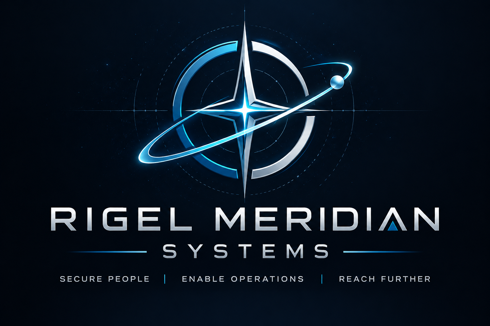

  

### Enterprise Security Engineering & Operations

**Building a secure enterprise, one decision at a time.**

Rigel Meridian Systems (RMS) is a fictional aerospace and defense technology company with approximately 75 employees, including 22 remote workers.

This cybersecurity homelab documents the design, implementation, and validation of an enterprise security program from the perspective of the organization's Security Manager.

[Explore the Engineering Journal](01-security-manager-journal.md){ .md-button .md-button--primary }
[View Company Profile](00-company-profile.md){ .md-button }

---

## Security Engineering Portal

- :material-book-open-page-variant: **Engineering Journal**

    ---

    Follow security assessments, architecture decisions, technical challenges, and lessons learned.

    [Read Journal](01-security-manager-journal.md)

- :material-server-network: **Infrastructure & Architecture**

    ---

    Explore network infrastructure, Windows and Linux systems, identity management, and enterprise architecture.

    [Network Architecture](02-network-architecture.md)

- :material-shield-lock: **Security & Compliance**

    ---

    Review security policies, governance decisions, risk assessments, and security program development.

    [Security Policies](04-security-policies.md)

- :material-laptop-account: **Security Projects**

    ---

    Follow security engineering projects from initial requirements through implementation and validation.

    [SEC-001 — Remote Workforce Security](projects/SEC-001-remote-workforce/requirements.md)

---

## Current Security Initiative

### SEC-001 — Remote Workforce Security

**Project Phase:** Architecture & Implementation

The initial RMS security initiative focuses on securing company-owned Windows laptops used by employees working remotely.

Key objectives include:

- Centralized endpoint management with Microsoft Intune
- Microsoft Entra ID identity modernization
- Phishing-resistant authentication
- BitLocker disk encryption
- Endpoint compliance and patch management
- Least-privilege access controls
- Security monitoring and logging

Implementation begins with a Windows 11 test workstation in the Proxmox homelab.

---

## About This Project

This project demonstrates practical cybersecurity engineering, enterprise architecture, security governance, and technical documentation.

All security decisions, configurations, and lessons learned are documented as the environment evolves.

**Maintained by:** [cruisicon](https://github.com/cruisicon)

!!! info "Educational Homelab"
    Rigel Meridian Systems is a fictional organization created for cybersecurity education and portfolio development. It does not represent a real company or production environment.
